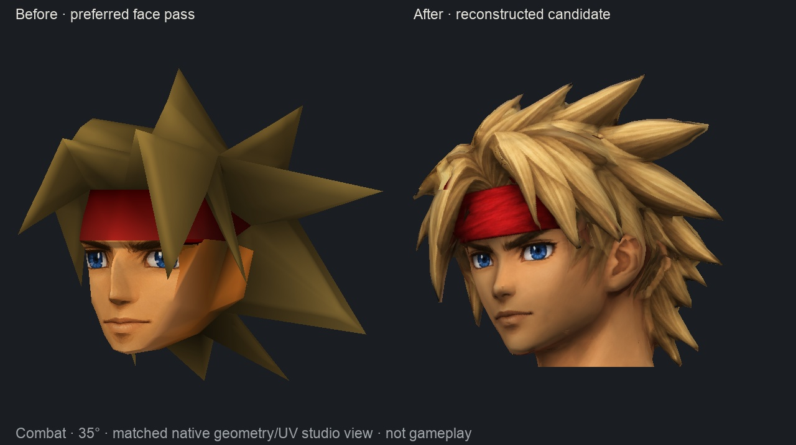
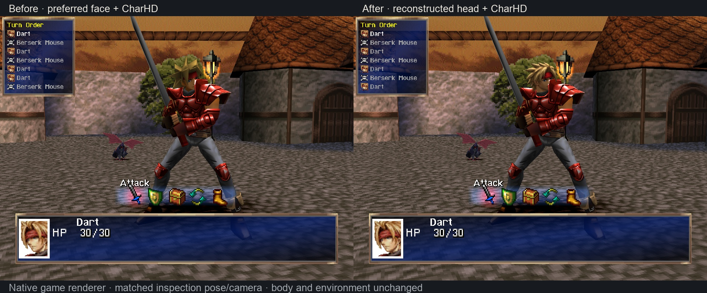
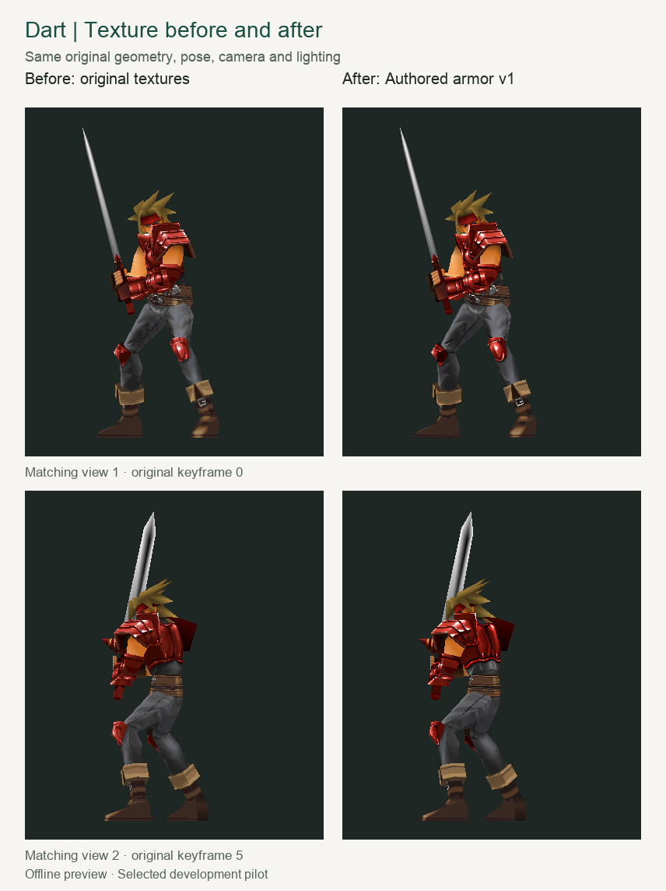
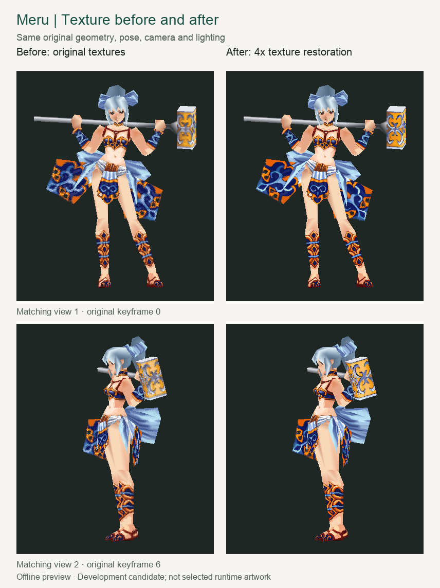
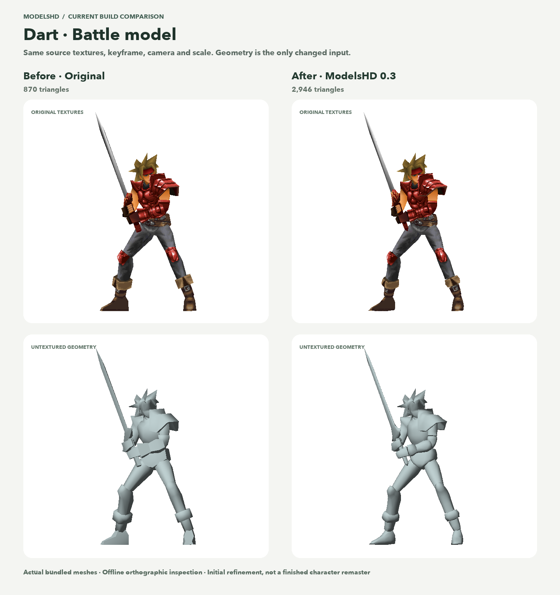
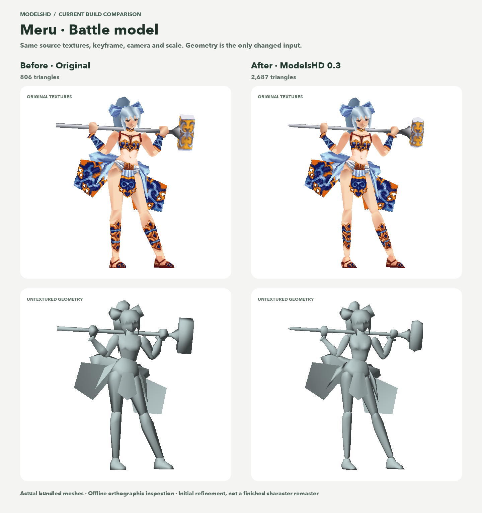
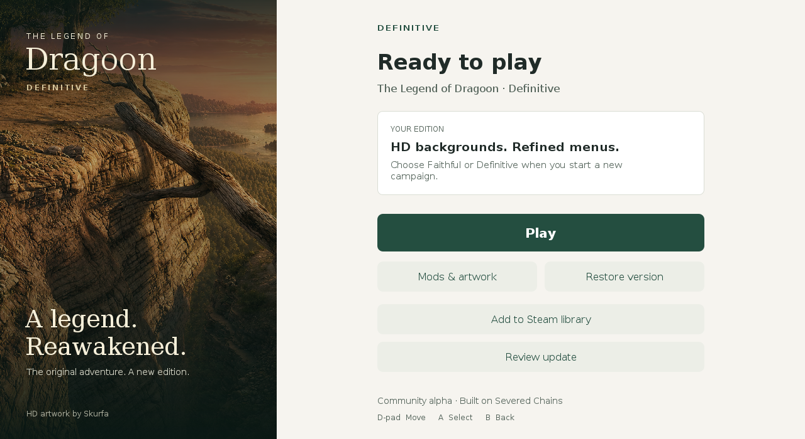

# Legend of Dragoon: Definitive

**A classic RPG. A new home on Steam Deck.**

## [⬇ Download the Steam Deck installer](https://github.com/gideonidoru/legend-of-dragoon-definitive/releases/latest/download/Install-Definitive.desktop)

HD artwork. Smoother models. Enhanced cinematics. One guided installation.

[Release notes](https://github.com/gideonidoru/legend-of-dragoon-definitive/releases/latest) · [Portable installer ZIP](https://github.com/gideonidoru/legend-of-dragoon-definitive/releases/latest/download/Definitive-Installer.zip) · [Installation help](docs/definitive/INSTALLER.md)

[Support Definitive on Ko-fi](https://ko-fi.com/gideonidoru).

**Legend of Dragoon: Definitive** is a Steam Deck-focused edition of *The Legend of Dragoon*, combining a native game port with curated HD mods, enhanced rendering and optional gameplay conveniences. Bring your four US game-disc images; the installer handles the engine, Java, mods and game preparation.

Built on [Severed Chains](https://github.com/Legend-of-Dragoon-Modding/Severed-Chains), Definitive adds an integrated presentation and installation experience: custom model and texture upgrades, restored interface and effect artwork, enhanced films, lighting improvements, campaign presets, and a launcher for updates and recovery. The story, recognizable character designs, original music and Addition-based combat remain central to the experience.

> **Development alpha.** The current installer includes SMAA, the accepted character/interface/effect artwork, expanded EnvHD field packs, independent engine clocks, FMV pacing fixes and the latest Repair/Reinstall/Uninstall recovery. The remaster is unfinished; physical Steam Deck gameplay and performance validation remain ongoing. [Check the included features before downloading](https://github.com/gideonidoru/legend-of-dragoon-definitive/releases/latest).

## The heroes you remember. In greater detail.

Dart’s crimson armor. Meru’s patterned hammer. The faces, hair and costumes that make the party unmistakable. Definitive brings those details into focus with smoother geometry, restored texture artwork and individually reconstructed character features.

### Dart · Rebuilt face. Sculpted hair. Painted detail.

*Earlier Definitive model → accepted CharHD reconstruction. Matched studio view of the actual geometry and materials; the left side already includes earlier face artwork.*

Dart’s reconstructed head combines modeled facial features, sculpted hair locks and a **2048 × 2048 painted material**. Custom body shapes and authored armor artwork complete the current presentation, while the original animation hierarchy and attachment points remain intact. The head, geometry and material activate together through **CharHD**.

<strong>See the reconstruction in the native game renderer</strong>

*Matched Mac renderer inspection with an enlarged actor. The body artwork and environment are unchanged between views. This is an inspection pose, not a Steam Deck gameplay capture.*

### HD textures · Detail you can see

Armor paneling, cloth patterns and weapon ornamentation deserve the same attention as silhouettes. These comparisons keep the original geometry, camera and lighting fixed so the artwork changes are visible on their own.

<table>
<tr><th>Dart · Authored armor</th><th>Meru · Texture restoration study</th></tr>
<tr>
<td width="50%"></td>
<td width="50%"></td>
</tr>
<tr>
<td>Crimson armor panels and painted costume detail. Selected development artwork on original geometry.</td>
<td>Hammer motifs and clothing patterns at 4× resolution. A preview candidate, currently not enabled in the installed mod.</td>
</tr>
</table>

### A foundation across the party

**ModelsHD** refines eligible surfaces across all nine party field models and all 19 party battle forms, including Dragoon forms. It also reaches supported enemies, NPCs and scenery. **CharHD** supplies the separate character artwork and accepted bespoke reconstructions. Broader smoothing and individually rebuilt characters are distinct layers of the remaster.

The bespoke character goal covers **Dart, Rose, Lavitz, Shana, Haschel, Albert, Meru, Kongol and Miranda**: faces and hair, costume panels, hands and grips, boots and weapons, guided by the original illustrations and in-game designs. Dart’s head is the first accepted reconstruction; his complete body and the remaining party reconstructions are unfinished. Dragoon-form reconstruction is a later adaptation pass.

<strong>Compare the geometry · Dart and Meru</strong>

<table>
<tr><th>Dart</th><th>Meru</th></tr>
<tr>
<td width="50%"></td>
<td width="50%"></td>
</tr>
</table>

*Matched offline previews from ModelsHD 0.3. Untextured views reveal the geometry changes. The broader 0.4 pass uses more conservative smoothing; these images show the earlier treatment.*

[Character reconstruction](docs/definitive/PARTY_RECONSTRUCTION.md) · [Model coverage](docs/definitive/MODELS_HD_WORLD_PASS.md) · [Comparison details](docs/definitive/images/comparisons/README.md).

## More detail. The same unmistakable world.

### Painted environments, restored for a modern screen

Skurfa's HD backgrounds preserve the game's distinctive painted setting. EnvHD extends that presentation with battle panoramas, location artwork and the parchment world map. The full remaster goal also covers terrain, battle surfaces, missing field scenes and environmental props, with the original foreground placement and occlusion preserved.

The [integrated EnvHD expansion](https://github.com/gideonidoru/legend-of-dragoon-definitive/pull/28) extends restoration to world-map terrain, battle surfaces and **4,892 selected field images**, including backgrounds and foreground layers. Four automatically installed field packs—**Env1HD through Env4HD**—share one EnvHD switch. Layer placement and visibility stay tied to the original scenes, and Skurfa’s existing artwork is preserved. All 5,162 generated field images have individual review records; 270 sources still need bespoke repair. Selected development artwork, broader animation/prop coverage and native gameplay quality remain under development. This expansion is included in the current combined release.

### Magic with sharper detail

FxHD restores effect textures across Dragoon spells and transformations, item magic, enemy and boss attacks, battle cutscenes, animated save points, world-map atmosphere and title flames. Its full texture catalog follows the original animated palettes, scrolling, transparency and blending, keeping each effect's movement and timing intact.

### A crisp interface, from portraits to battle prompts

UIHD restores all nine party portraits, menus, dialogue borders, save-card artwork, world-map markers, chapter cards and credits. Combat cues retain their original size and timing, so clearer artwork supports the precision Additions demand. Smooth fonts remain available in Graphics settings.

## Technical presentation

Definitive extends Severed Chains' shared rendering, texture-loading, audio and timing systems. These improvements support the HD artwork across field maps, battles, the world map and model-based cutscenes, while retaining the game's original animation, palette effects and combat timing.

### Rendering and materials

| Technology | What it adds |
| --- | --- |
| **SMAA 1x High** | Three-pass spatial anti-aliasing for cleaner silhouettes and diagonals. Dedicated interface coverage protects dialogue, menus and Addition prompts. No temporal history or frame generation. |
| **Per-fragment model lighting** | Normalized interpolated normals produce smoother light across supported surfaces, with restrained diffuse transitions and the scene's original light directions and colors. |
| **Surface materials** | Cloth, skin, leather and metal responses, with per-face roughness and optional authored normal/roughness maps. A subtle shared surface finish also supports original models; authored maps take precedence. |
| **Scene-aware lighting** | Artist-supplied profiles can match models to painted environments. Otherwise, restrained profiles follow the game's native lights and scripted changes, resetting between scenes. |
| **Soft contact shadows** | Feathered shadows for field and battle actors, scripted shadow effects and the world-map traveler, retaining original placement and attachment behavior. |
| **Dynamic effect lights** | Up to four nearby luminous effects or save-point emitters illuminate supported opaque geometry. Selective bloom adds glow to explicitly emissive content; reduced-flashing settings suppress these added contributions. |
| **HD filtering and sharpening** | Mipmaps, supported anisotropic filtering up to 4×, and bounded contrast-adaptive sharpening. Palette textures, transparency masks and unpadded interface sheets retain their required sampling. |

### High-resolution artwork, original animation

**Character geometry and materials.** Dart’s accepted head uses **5,748 triangles** and a **2K material**, integrated through twelve selected field/battle part packs with custom body geometry. Exact source identities bind each replacement to the correct model. Geometry and material are accepted together; original CPU geometry, animation hierarchy and script-facing indices remain unchanged. Disabling CharHD restores the selected ModelsHD or original presentation. [Character integration](integrations/charhd/production/party-reconstruction/DART_PROMOTION.md).

**Palette-live effects.** FxHD's shared indexed detail path resolves restored colors from the current palette. Texture writes, copies and scrolling retain native animation and transparency. One persistent **16 MiB GPU companion** serves the effect system, with no GPU texture allocation per particle.

**Protected interface rendering.** UIHD keeps native clipping, logical coordinates, animation offsets and transparency while displaying larger artwork. Native palette variants load on demand within a **32 MiB source/restoration GPU budget**. Current-frame pages remain pinned; unused pages can be evicted, including while paused. Changed or invalid sources fall back to original artwork.

**Bounded loading.** A shared **64 MiB decoded-artwork cache** reuses image data. Low-priority workers prepare native field backgrounds and eligible HD images during loading; GPU work stays on the renderer thread. Scene changes cancel obsolete preparation. These are component budgets, not a total game-memory or Steam Deck performance guarantee.

### Cinematics, audio and pacing

**All 18 enhanced films** use bounded streaming at 1280×768, retaining the original 15 fps motion and soundtrack. Enhanced and original video follow actually played audio; original-video fallback preserves its native 15 fps cadence. Cinematic presentation bypasses gameplay frame skipping and restores normal gameplay settings afterward. Cancellation and original-video fallback remain available.

**PCM audio preservation** avoids an additional lossy encode after decoding prerecorded XA clips, retaining the original score, voices and effects. Queue handling preserves clip endings and counts only audio that actually played, including empty starts, underruns and output disconnections.

**Reliable output selection.** The default audio setting follows the operating system’s default output. Explicit device choices remain supported; unavailable or failed outputs trigger a bounded search for a working alternative without rewriting your saved preference. A lost audio device cannot fast-forward a cinematic by crediting its abandoned queue. Enhanced game films fall back to original playback when the output generation changes; original films and the launch video stop safely.

**Independent engine clocks** separate gameplay simulation from presentation. Monotonic fixed steps advance scripts, model animation and gameplay at the selected game speed, with bounded catch-up after a stall. Hardware/minigame timers and sample-driven audio keep their own rates. Movie exits restore input, display and pause state independently; skip prompts follow movie time. Addition windows remain unchanged.

### Graphics reliability and control

Failed shader reloads retain the working program. Texture uploads select the correct binding, deleted textures clear cached bindings, and stale artwork callbacks cannot restore an obsolete mod selection. Shared resources have explicit limits and cleanup paths.

Native character uploads and deferred texture retirement retain renderer-thread ownership, including cancellation and failed uploads.

Presentation controls live in **Graphics**, independently of campaign presets. The pipeline uses conventional rendering with assets prepared before installation. Whole-campaign visual review and physical Steam Deck frame-time, memory and power measurements remain ongoing.

### Installation, save compatibility and recovery

**HD support for existing campaigns.** The managed launcher activates installed HD modules even when a campaign predates them. Visual defaults leave existing save bytes untouched. Explicit module opt-outs persist, custom gameplay-mod selections remain intact, and changes in the Mods menu take effect only when accepted. New-campaign choices are saved when you start the game.

**Durable artwork preferences.** Accepted HD choices use an atomic preferences-file replacement followed by file and directory synchronization on Linux and macOS. A failed write keeps the selection screen open so you can retry or cancel.

**Recovery after an interrupted launch.** Repair and Reinstall clear stale launch records and close verified game/launcher processes belonging to that installation before maintenance. Ownership checks distinguish those processes from other applications, and operation locks remain held through verification and activation. Saves, settings, module choices and imported discs are retained; Repair also retains prepared game data.

[Rendering technology](docs/definitive/RENDERING_LIGHTING.md) · [Cinematic playback](docs/definitive/CINEMATIC_TIMING.md) · [Audio](docs/definitive/AUDIO_VALIDATION.md) · [Engine pacing](docs/definitive/ENGINE_PACING.md) · [HD module behavior](docs/definitive/HD_MOD_ACTIVATION.md) · [Launch recovery](docs/definitive/MAINTENANCE_GAME_RECOVERY.md).

## Your campaign. Your preferences.

Start with **Definitive** for saving anywhere, battle autosaves, running by default, faster text, shorter transitions, enemy HP bars and turn-order information. Choose **Faithful** for settings closer to the original game.

Both presets preserve normal Additions and timing windows, default to **1× rewards**, and leave Addition feedback off. Optional settings add equipment filtering and sorting, quantity buying and selling, binding-aware action hints, XP/gold multipliers, and timing feedback. Feedback helps identify Early, Late or Wrong Button results without changing hit windows or damage. Difficulty overhauls are not bundled. [Compare presets](docs/definitive/PRESETS.md) · [Explore the settings](docs/definitive/QOL_SETTINGS.md).

## Ready to play on Steam Deck

1. Enter **Desktop Mode** and [download the installer](https://github.com/gideonidoru/legend-of-dragoon-definitive/releases/latest/download/Install-Definitive.desktop).
2. Open `Install-Definitive.desktop` in **Dolphin**. Allow execution if prompted.
3. Choose a folder and supply your **four US game-disc images**, or reuse an existing installation's discs. BIN/raw ISO files and ZIP, RAR or 7z containers are supported.
4. Let setup prepare the game, add the optional Steam shortcut, and launch from Steam or the Definitive launcher.

The current `.desktop` checks and fetches the latest installer every time it runs. Replace an older pinned `.desktop` once; the new saved copy stays current.

If an older “Manage Installation” or Play shortcut fails before setup opens, download the installer again and select **Repair**, **Reinstall** or **Uninstall** for your existing installation. Repair refreshes the installed launcher when its old hosted release has been retired.

Custom folders and SD cards are supported. Allow space for the game package, Java, your discs and prepared game data; the larger environment expansion also needs additional room for its four field packs. Check the release notes for the package you are installing. Game discs are not included, and source images stay untouched.

*Linux launcher preview.*

The launcher brings **Play, Update, Repair and Restore** together. Update reuses unchanged files; Repair retrieves missing or changed application files. Reinstall replaces the application while keeping saves, settings, custom mods and imported discs. The latest recovery improvements handle stale or interrupted launches automatically, closing this installation’s verified game processes when Repair or Reinstall needs to proceed. [Installation and recovery guide](docs/definitive/INSTALLER.md).

## One installation. Seven HD modules.

Choose artwork modules individually in the game's **Mods** menu. In the newer source, installed HD modules also work with existing campaigns without requiring a new game. Your explicit opt-outs are remembered, and cancelling a menu change leaves the previous choices intact. The launcher’s original/HD preference controls Skurfa backgrounds and ModelsHD; the other five modules have their own choices in Mods. [Artwork selection details](docs/definitive/HD_MOD_ACTIVATION.md).

| Module | Enhancement |
| --- | --- |
| **[Skurfa's HDR Backgrounds](https://github.com/IntiArtHub/skurfas-upscaled-hdr-backgrounds)** | Remastered field backgrounds and foreground layers. |
| **[ModelsHD](integrations/modelshd/README.md)** | Refined character, enemy, NPC and scenery geometry. |
| **[CharHD](integrations/charhd/README.md)** | Reconstructed character models, restored textures and authored costume detail. |
| **[EnvHD](docs/definitive/ENVHD_STATUS.md)** | Battle panoramas, world-map artwork and environment restoration. |
| **[UIHD](docs/definitive/UIHD_PRODUCTION.md)** | Portraits, menus, interface artwork and combat cues. |
| **[FxHD](integrations/fxhd/README.md)** | Spell, attack, transformation and animated effect textures. |
| **[FMVHD](integrations/fmvhd/README.md)** | Enhanced versions of all 18 cinematics. |

The scope is the whole campaign. Character faces and costumes across the party, NPCs and enemies, plus remaining field scenes, terrain, battle materials, props and animated surfaces still need work. Including all seven modules does not mean every asset is finished. [Visual direction](docs/definitive/CHARACTER_REMASTER.md) · [Character coverage](docs/definitive/CHARHD_PRODUCTION.md) · [Environment coverage](docs/definitive/ENVHD_STATUS.md).

## Built with the community

Definitive depends on the **Severed Chains maintainers and Legend of Dragoon Modding community**, **Skurfa**, and other community creators, including the inspiration from **Quality of Life+**. Their attribution and license notices are preserved. [Credits](CREDITS) · [Source notices](credits.txt).

This is an unofficial project, unaffiliated with Sony or the original rights holders. The engine uses [AGPL v3](LICENSE); mods and artwork retain their own notices. Custom Definitive code, meshes and artwork are public project work. Game discs are not distributed, and the code license does not grant rights to the original game's assets. [Asset policy](docs/definitive/ASSET_POLICY.md) · [FMVHD notices](integrations/fmvhd/README.md).

Contributors: [Build instructions](docs/definitive/SETUP.md) · [Rendering](docs/definitive/RENDERING_LIGHTING.md) · [Architecture](docs/definitive/ARCHITECTURE.md) · [Upstream approach](docs/definitive/UPSTREAM.md) · [Original Severed Chains README](docs/upstream/README.md).
