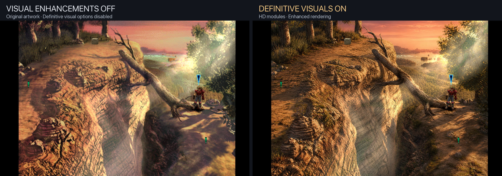
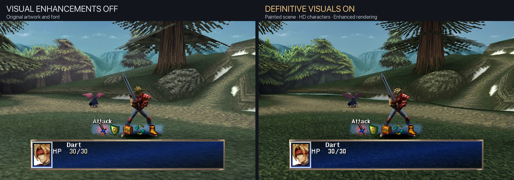
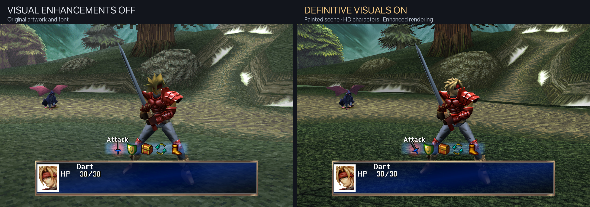
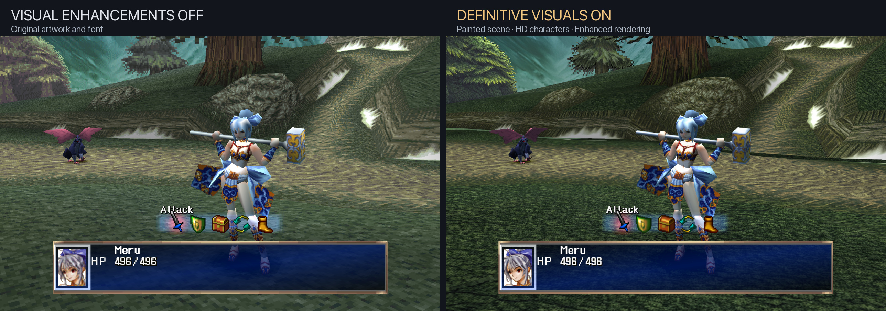

# Legend of Dragoon: Definitive

**Rediscover Endiness. Built for Steam Deck.**

## [⬇ Download the Steam Deck installer](https://github.com/gideonidoru/legend-of-dragoon-definitive/releases/latest/download/Install-Definitive.desktop)

Reconstructed characters. Restored HD artwork. Enhanced lighting and cinematics. One guided installation.

[Release notes](https://github.com/gideonidoru/legend-of-dragoon-definitive/releases/latest) · [Portable installer ZIP](https://github.com/gideonidoru/legend-of-dragoon-definitive/releases/latest/download/Definitive-Installer.zip) · [Installation help](docs/definitive/INSTALLER.md)

[Support Definitive on Ko-fi](https://ko-fi.com/gideonidoru).

**Legend of Dragoon: Definitive** is a Steam Deck-focused edition of *The Legend of Dragoon*, combining Severed Chains’ native game port with an integrated visual remaster, enhanced rendering and optional gameplay conveniences. Bring your four US game-disc images; the installer handles the engine, Java, mods and game preparation.

Built on [Severed Chains](https://github.com/Legend-of-Dragoon-Modding/Severed-Chains), Definitive adds an integrated presentation and installation experience: custom model and texture upgrades, restored interface and effect artwork, enhanced films, lighting improvements, campaign presets, and a launcher for updates and recovery. The story, recognizable character designs, original music and Addition-based combat remain central to the experience.

> **Development alpha.** Character and environment restoration are unfinished, and physical Steam Deck gameplay and performance validation remain ongoing.

## See the difference in-engine

Sharper artwork across the scene. A reconstructed Dart. Smoother surfaces, cleaner edges and a clearer battle interface. These matched views show the visual layers working together in the actual game renderer.

*Forest cliff · Original visuals → Definitive visuals. Matched 1280 × 800 field captures with the same camera, actor positions and layered scenery.*

*Visual enhancements off → Definitive visuals on. Same 1280 × 800 output, camera and character pose. Captured in the native Mac renderer at normal actor scale.*

Each comparison uses matching cameras, poses and output resolution, with Definitive’s HD modules and visual rendering options switched off on the left and on on the right. [Image and capture details](docs/definitive/images/comparisons/README.md#matched-in-engine-visual-comparisons).

## The heroes you remember. In greater detail.

Recognizable silhouettes. Richer surfaces. Faces, hair and costumes that hold up on a modern screen. Definitive combines refined geometry, restored textures and enhanced lighting to bring the party into focus.

### Dart · Rebuilt face. Sculpted hair. Painted detail.

Dart’s reconstructed head combines modeled facial features, sculpted hair locks and a **2048 × 2048 painted material**. Crimson armor panels and painted costume details complement the new head. His original combat and cutscene animations are preserved.

*Original visuals → Definitive visuals. Matching camera and pose, with Dart at normal scale.*

### Meru · Smoother geometry. The same unmistakable design.

Meru’s hammer, costume and silhouette retain their familiar shape. Refined surfaces and enhanced lighting soften angular transitions while preserving her original animation and character design.

*Original visuals → Definitive visuals. Matching camera and pose, with Meru at normal scale.*

### Detail across the party

**ModelsHD** refines eligible surfaces across all nine party field models and all 19 party battle forms, including Dragoon forms. It also reaches supported enemies, NPCs and scenery. **CharHD** adds character artwork, painted costume detail and Dart’s reconstructed head.

The visual direction stays close to the original illustrations and in-game designs: distinctive faces and hair, recognizable armor and clothing, and the weapons that define each character. The goal is a consistent restoration across **Dart, Rose, Lavitz, Shana, Haschel, Albert, Meru, Kongol and Miranda**.

[Character features](docs/definitive/CHARACTER_REMASTER.md) · [Model coverage](docs/definitive/MODELS_HD_WORLD_PASS.md) · [Image details](docs/definitive/images/comparisons/README.md).

## More detail. The same unmistakable world.

### Painted environments, restored for a modern screen

Explore painted towns, forests and interiors with **4,917 restored field images**, covering backgrounds and foreground layers. Skurfa’s HD backgrounds retain their own artwork and attribution; EnvHD expands the world around them with additional field art, battle panoramas, location landscapes and the parchment map. World-map terrain and selected battle floors, walls and scenery also receive restored textures.

Foregrounds retain their original placement, visibility and depth. The installer supplies **Env1HD through Env4HD** as four resource packs under one EnvHD switch, with no separate pack setup.

Hand-painted artwork adds detail to bedding, upholstery, woodwork, foliage and architectural motifs, with **31 painted field replacements** and restoration across twelve battle motifs. Where a replacement is unavailable, the original artwork keeps the scene intact. [Environment coverage](docs/definitive/ENVHD_FULL_COVERAGE.md).

### Magic with sharper detail

FxHD supplies **2,160 unique 2× detail maps** across the audited effect-texture catalog. Coverage includes Dragoon spells and transformations, item magic, enemy and boss attacks, battle cutscenes, animated save points, world-map atmosphere and title flames. Its detail maps follow the original animated palettes, scrolling, transparency and blending, preserving the native palette-driven animation path.

### A crisp interface, from portraits to battle prompts

UIHD restores all nine party portraits, menus, dialogue borders, save-card artwork, world-map markers, chapter cards and credits. Combat cues retain their original size and timing, so clearer artwork supports the precision Additions demand. Smooth fonts remain available in Graphics settings.

## Your campaign. Your preferences.

Start with **Definitive** for saving anywhere, battle autosaves, running by default, faster text, shorter transitions, enemy HP bars and turn-order information. Choose **Faithful** for settings closer to the original game.

Both presets preserve normal Additions and timing windows, default to **1× rewards**, and leave Addition feedback off. Optional settings add equipment filtering and sorting, quantity buying and selling, binding-aware action hints, XP/gold multipliers, and timing feedback. Feedback helps identify Early, Late or Wrong Button results without changing hit windows or damage. Difficulty overhauls are not bundled. [Compare presets](docs/definitive/PRESETS.md) · [Explore the settings](docs/definitive/QOL_SETTINGS.md).

## Ready to play on Steam Deck

1. Enter **Desktop Mode** and [download the installer](https://github.com/gideonidoru/legend-of-dragoon-definitive/releases/latest/download/Install-Definitive.desktop).
2. Open `Install-Definitive.desktop` in **Dolphin**. Allow execution if prompted.
3. Choose a folder and supply your **four US game-disc images**, or reuse an existing installation's discs. BIN/raw ISO files and ZIP, RAR or 7z containers are supported.
4. Let setup prepare the game, add the optional Steam shortcut, and launch from Steam or the Definitive launcher.

Keep the downloaded installer: **each launch retrieves and checksum-verifies the latest setup**. Replace an older pinned `.desktop` once; the current saved copy keeps following new releases.

If an older “Manage Installation” or Play shortcut fails before setup opens, download the installer again and select **Repair**, **Reinstall** or **Uninstall** for your existing installation. Repair refreshes the installed launcher when its old hosted release has been retired.

Custom folders and SD cards are supported. Allow roughly **12 GB free for initial setup**, in addition to source discs already present; actual use depends on disc compression, and retained updates need additional room. Setup downloads the engine, artwork, dependencies and Java automatically. An internet connection is required. Game discs are not included, and source images stay untouched.

*Linux launcher preview.*

### Keep playing. Keep your saves.

The launcher offers Play, updates and local version restore; the installer also provides maintenance for an existing installation.

| Action | What it does |
| --- | --- |
| **Update** | Installs a newer release, reusing verified unchanged files and downloading changed or new ones. |
| **Repair** | Replaces missing or damaged files. If the old hosted release has been retired, retrieves the verified current version and refreshes the launcher. |
| **Reinstall** | Downloads the entire application again and prepares a fresh workspace, retaining saves, settings, custom mods and imported discs. |
| **Restore** | Returns to a retained local version. |
| **Uninstall** | Removes managed application/workspace files while retaining personal data. Imported discs stay unless you choose to remove them. |

Repair, Reinstall and Uninstall can recover from stale or damaged launch records, closing this installation’s verified game processes before maintenance. [Installation and recovery guide](docs/definitive/INSTALLER.md).

## One installation. Seven HD modules.

Choose artwork modules individually in the game's **Mods** menu. Installed HD modules also work with existing campaigns without requiring a new game. Your explicit opt-outs are remembered, and cancelling a menu change leaves the previous choices intact. The launcher’s original/HD preference controls Skurfa backgrounds and ModelsHD; the other five modules have their own choices in Mods. [Artwork selection details](docs/definitive/HD_MOD_ACTIVATION.md).

| Module | Enhancement |
| --- | --- |
| **[Skurfa's HDR Backgrounds](https://github.com/IntiArtHub/skurfas-upscaled-hdr-backgrounds)** | Remastered field backgrounds and foreground layers. |
| **[ModelsHD](integrations/modelshd/README.md)** | Refined character, enemy, NPC and scenery geometry. |
| **[CharHD](integrations/charhd/README.md)** | Dart’s reconstructed head, restored character textures and authored costume detail. |
| **[EnvHD](docs/definitive/ENVHD_FULL_COVERAGE.md)** | 4,917 field images, battle panoramas, world-map artwork, terrain and selected battle materials. |
| **[UIHD](docs/definitive/UIHD_PRODUCTION.md)** | Portraits, menus, interface artwork and combat cues. |
| **[FxHD](integrations/fxhd/README.md)** | Spell, attack, transformation and animated effect textures. |
| **[FMVHD](integrations/fmvhd/README.md)** | Enhanced versions of all 18 cinematics. |

Explore the character, environment and interface features in more detail. [Visual direction](docs/definitive/CHARACTER_REMASTER.md) · [Character coverage](docs/definitive/CHARHD_PRODUCTION.md) · [Environment coverage](docs/definitive/ENVHD_FULL_COVERAGE.md).

## Technical presentation

Definitive extends Severed Chains' shared rendering, texture-loading, audio and timing systems. These improvements support the HD artwork across field maps, battles, the world map and model-based cutscenes, while retaining the game's original animation, palette effects and combat timing.

### Rendering and materials

| Technology | What it adds |
| --- | --- |
| **SMAA 1x High** | Three-pass spatial anti-aliasing for cleaner silhouettes and diagonals. Dedicated interface coverage protects dialogue, menus and Addition prompts. No temporal history or frame generation. |
| **Per-fragment model lighting** | Normalized interpolated normals produce smoother light across supported surfaces, with restrained diffuse transitions and the scene's original light directions and colors. |
| **Surface materials** | Cloth, skin, leather and metal responses, with per-face roughness and optional authored normal/roughness maps. A subtle shared surface finish also supports original models; authored maps take precedence. |
| **Scene-aware lighting** | Artist-supplied profiles can match models to painted environments. Otherwise, restrained profiles follow the game's native lights and scripted changes, resetting between scenes. |
| **Soft contact shadows** | Feathered shadows for field and battle actors, scripted shadow effects and the world-map traveler, retaining original placement and attachment behavior. |
| **Dynamic effect lights** | Up to four nearby luminous effects or save-point emitters illuminate supported opaque geometry. Selective bloom adds glow to explicitly emissive content; reduced-flashing settings suppress these added contributions. |
| **HD filtering and sharpening** | Mipmaps, supported anisotropic filtering up to 4×, and bounded contrast-adaptive sharpening. Palette textures, transparency masks and unpadded interface sheets retain their required sampling. |

### High-resolution artwork, original animation

**Character geometry and materials.** Dart’s reconstructed head uses **5,748 triangles** and a **2K material**, integrated across twelve field and battle part packs with custom body geometry. Model identities bind each replacement to the correct character. Geometry and materials load together while preserving the original CPU geometry, animation hierarchy and script-facing indices. Disabling CharHD restores the ModelsHD or original presentation. [Character integration](integrations/charhd/production/party-reconstruction/DART_PROMOTION.md).

**Palette-live effects.** FxHD's shared indexed detail path resolves restored colors from the current palette. Texture writes, copies and scrolling retain native animation and transparency. One persistent **16 MiB GPU companion** serves the effect system, with no GPU texture allocation per particle.

**Protected interface rendering.** UIHD keeps native clipping, logical coordinates, animation offsets and transparency while displaying larger artwork. Native palette variants load on demand within a **32 MiB source/restoration GPU budget**. Current-frame pages remain pinned; unused pages can be evicted, including while paused. Changed or invalid sources fall back to original artwork.

**Source-bound environments.** Field replacements match decoded source pixels and a pinned artwork checksum before allocation. Separate foreground layers retain their script slots, movement, translucency and depth. Painted-image inputs have bounded dimensions and decode checks before pixel allocation; invalid or mismatched artwork falls back to the original layer. The environment library contains 4,917 field replacements. Unmatched or unavailable replacements retain the original artwork. [Full environment scope](docs/definitive/ENVHD_FULL_COVERAGE.md).

**Bounded loading.** A shared **64 MiB decoded-artwork cache** reuses image data. Low-priority workers prepare native field backgrounds and eligible HD images during loading; GPU work stays on the renderer thread. Scene changes cancel obsolete preparation. These are component budgets, not a total game-memory or Steam Deck performance guarantee.

### Cinematics, audio and pacing

**All 18 enhanced films** use bounded streaming at 1280×768, retaining the original 15 fps motion and soundtrack. Enhanced and original video follow actually played audio; original-video fallback preserves its native 15 fps cadence. Cinematic presentation bypasses gameplay frame skipping and restores normal gameplay settings afterward. Cancellation and original-video fallback remain available.

**PCM audio preservation** avoids an additional lossy encode after decoding prerecorded XA clips, retaining the original score, voices and effects. Queue handling preserves clip endings and counts only audio that actually played, including empty starts, underruns and output disconnections.

**Reliable output selection.** The default audio setting follows the operating system’s default output. Explicit device choices remain supported; unavailable or failed outputs trigger a bounded search for a working alternative without rewriting your saved preference. A lost audio device cannot fast-forward a cinematic by crediting its abandoned queue. Enhanced game films fall back to original playback when the output generation changes; original films and the launch video stop safely.

**Independent engine clocks** separate gameplay simulation from presentation. Monotonic fixed steps advance scripts, model animation and gameplay at the selected game speed, with bounded catch-up after a stall. Hardware/minigame timers and sample-driven audio keep their own rates. Movie exits restore input, display and pause state independently; skip prompts follow movie time. Addition windows remain unchanged.

### Graphics reliability and control

Failed shader reloads retain the working program. Texture uploads select the correct binding, deleted textures clear cached bindings, and stale artwork callbacks cannot restore an obsolete mod selection. Shared resources have explicit limits and cleanup paths.

Native character uploads and deferred texture retirement retain renderer-thread ownership, including cancellation and failed uploads.

**Depth-buffer resets.** The engine restores depth writes before clearing the depth buffer in both OpenGL and OpenGL ES. This prevents a previous draw’s disabled depth-write state from blocking the reset and carrying stale depth into later rendering. [Technical validation](docs/definitive/DEPTH_CLEAR_REGRESSION.md).

Presentation controls live in **Graphics**, independently of campaign presets. Artwork is prepared before installation; the game uses conventional rendering during play.

### Installation, save compatibility and recovery

**HD support for existing campaigns.** The managed launcher activates installed HD modules even when a campaign predates them. Visual defaults leave existing save bytes untouched. Explicit module opt-outs persist, custom gameplay-mod selections remain intact, and changes in the Mods menu take effect when you confirm them. New-campaign choices are saved when you start the game.

**Durable artwork preferences.** Your HD choices use an atomic preferences-file replacement followed by file and directory synchronization on Linux and macOS. A failed write keeps the selection screen open so you can retry or cancel.

**Recovery after an interrupted launch.** Repair, Reinstall and Uninstall recover from stale, missing or corrupt launch records and close verified game/launcher processes belonging to that installation before maintenance. Ownership checks distinguish those processes from other applications, and operation locks remain held through verification and activation. Repair and Reinstall retain saves, settings, module choices and imported discs. Same-release Repair also retains prepared game data; Uninstall retains personal data and imported discs unless disc removal is explicitly selected.

**Verified delivery at larger sizes.** ZIP64 support accommodates the expanded HD package. Checksum-addressed file delivery installs the complete inventory even when a full platform archive exceeds hosting limits. Update and Repair reuse verified matching files; full Reinstall downloads every payload again. Files are checked before activation, and failed transfers cannot activate an incomplete package. When an older hosted version has been retired, Repair can retrieve the verified current release and refresh the installed launcher while retaining personal data and the previous workspace. [Delivery technology](docs/definitive/FILE_DELIVERY.md).

[Rendering technology](docs/definitive/RENDERING_LIGHTING.md) · [Cinematic playback](docs/definitive/CINEMATIC_TIMING.md) · [Audio](docs/definitive/AUDIO_VALIDATION.md) · [Engine pacing](docs/definitive/ENGINE_PACING.md) · [HD module behavior](docs/definitive/HD_MOD_ACTIVATION.md) · [Launch recovery](docs/definitive/MAINTENANCE_GAME_RECOVERY.md).

## Built with the community

Definitive depends on the **Severed Chains maintainers and Legend of Dragoon Modding community**, **Skurfa**, and other community creators, including the inspiration from **Quality of Life+**. Their attribution and license notices are preserved. [Credits](CREDITS) · [Source notices](credits.txt).

This is an unofficial project, unaffiliated with Sony or the original rights holders. The engine uses [AGPL v3](LICENSE); mods and artwork retain their own notices. Custom Definitive code, meshes and artwork are public project work. Game discs are not distributed, and the code license does not grant rights to the original game's assets. [Asset policy](docs/definitive/ASSET_POLICY.md) · [FMVHD notices](integrations/fmvhd/README.md).

Contributors: [Build instructions](docs/definitive/SETUP.md) · [Rendering](docs/definitive/RENDERING_LIGHTING.md) · [Architecture](docs/definitive/ARCHITECTURE.md) · [Upstream approach](docs/definitive/UPSTREAM.md) · [Original Severed Chains README](docs/upstream/README.md).
