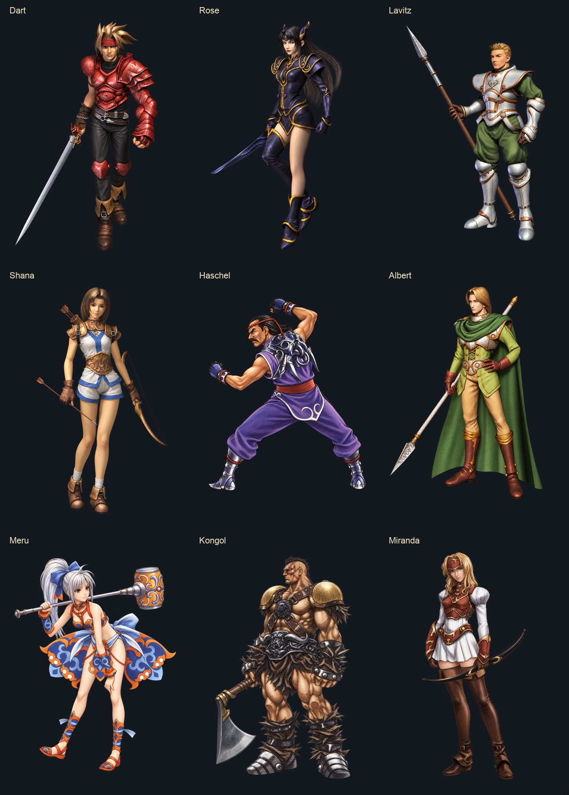

# CharHD: original-design party set

The next [Dart articulated-surface checkpoint](DART_JOINT_COLLAR_STUDY.md) records a source-bound elbow construction study, 144 stored-pose checks and a matched custom-geometry comparison. It does not promote or change these nine static sculpts.

October 11, 2026. The owner approved extending the reviewed direction to all nine normal party characters. This checkpoint contains **nine custom artwork candidates, nine editable static body GLBs and nine 2048 × 2048 base-color atlases**. All are public CharHD authoring assets, with exact prompts and bounded provenance/bake receipts. They remain on the draft branch until individual visual acceptance and native animation checks; they are not new installed actor replacements.



## Reference and design checks

The [reference catalog](../../integrations/charhd/production/party-reconstruction/original-art-reference-catalog.json) now identifies a normal-form control for every character, including Miranda. Original reference pixels and full native actor controls remain outside Git. Each artwork receipt records its reference URL, hash and dimensions. These are community/gallery reproductions; original publication lineage is unresolved. Meru's larger illustration was located through Pinterest, and Miranda's small illustration cannot resolve fine linework alone. Native model/texture corroboration remains necessary.

All nine original/candidate pairs were inspected at full-body overview. The new set restores the distinct designs below. “Restored” describes visible construction/color relationships; it does not assert pixel-exact ornaments or final acceptance.

The required feature/native-reference audit was not completed before these inference jobs. This is an **out-of-sequence static experiment**, not completion of the fidelity gate. Extending the approved direction across nine characters did not approve exact motifs or waive that gate. Complete the original illustration plus native front/side/rear reference sheet, aligned detail comparisons and matched/mismatched/unresolved feature record before further inference or fitting. The [two-axis review](../../integrations/charhd/production/party-reconstruction/REVIEW-original-design-v3.md) records this process breach and the remaining delivery gaps.

| Character | Visible original design retained | Detail checks still required |
| --- | --- | --- |
| Dart | Asymmetric red armor, segmented abdomen, distinctive belt fittings, pointed ochre ankle wraps and ornate sword guard | Guard/belt close views, native skull/pivot fit and rear armor construction |
| Rose | Purple-black outfit, gold loops, pointed hair ornaments, long hair and asymmetric leg coverage | Exact gold linework, separate hair surfaces and native sword grip |
| Lavitz | Silver armor with bronze edges, green cloth, chest emblem and engraved lance | Chest emblem tracing, overlapping plates and gauntlet/lance attachments |
| Shana | White tunic **and shorts**, blue trim, bronze shoulder/waist fittings, brown bob, gloves and bow | Bowstring is not clearly preserved in the new artwork; confirm fittings, arrow/string geometry and grip |
| Haschel | Dark hair/moustache, purple trousers, red-brown sash, pale scroll panels, fist guards and silver footwear | Exact scroll layout and whether the new raised metallic treatment matches the native material |
| Albert | Green cloak/scarf and tunic, silver/bronze fittings, oval belt, tan trousers, tall brown boots and spear | Small closures/motifs, cloak topology, source proportions and spear attachment |
| Meru | Silver ponytail/blue bow, orange/blue/white dancer outfit, split panels, wrapped sandals and decorated hammer | Exact swirl layouts remain unaccepted; source lineage, finger contacts and separate cloth/ribbon geometry |
| Kongol | Giganto build, crest/face markings, ochre shoulders, crossed straps, sculpted waist, spiked guards and axe | Fine waist/face motifs, spike topology and axe details partly outside the source illustration |
| Miranda | Blond hair/circlet, red-brown/gold armor, white sleeves and pleated skirt, brown leg coverings and bow | Fine ornament tracing, bow construction/string, native grip and proportions |

Shana's old “pale dress” description was incorrect for the selected normal-form CG reference. Historical generated files/prompts remain preserved as evidence; they are not canonical inputs.

After freezing the authoring checkpoint, the original field and battle sources were hash-verified and rendered at three camera angles for every character: **18 original forms and 54 original reference views**. The private sheets were inspected; the [public native-reference audit](../../integrations/charhd/production/party-reconstruction/NATIVE-REFERENCE-AUDIT-original-design-v3.json) includes only hashes, observations and matched/mismatched/unresolved feature records. This is source inspection, not testing the new models in the game.

The controls expose important form distinctions: Shana's field model has a rear braid, Albert's field model has a long rear hair strand, and Dart's field ankle wraps differ from his battle boot cuffs. Those details must survive the replacement; the CG-facing artwork cannot prove their absence. The new static bodies do not yet preserve all of them. Haschel's original front tunic/neckline also constrains the face of the body not visible in his back-facing concept art. Exact motifs, close attachment checks and registered source/candidate detail comparisons remain unfinished; no character design is locked by this audit. The later inspection does not retroactively cure the inference sequencing breach.

## Actual mesh inspection

Each character folder under [party reconstruction](../../integrations/charhd/production/party-reconstruction/AUTHORING.md) has an `original-design-v3` directory containing:

- `render-v1.png` and its exact prompt; Haschel's framing edit is `render-v2.png` with a separate prompt.
- `body-sculpt-v1.glb`, a static 24,000-triangle mesh with an embedded atlas.
- `body-basecolour-v1.png`, the matching editable 2K atlas.
- `artwork-receipt.json`, `reconstruction-receipt.json` and `sculpt-review.jpg`.

The [inventory](../../integrations/charhd/production/party-reconstruction/original-design-v3.json) pins the selected files and records integrity checks. The mesh boards show actual GLB geometry, not illustrations presented as game screenshots: [Dart/Rose/Lavitz](../../integrations/charhd/production/party-reconstruction/party-original-design-v3-meshes-1.jpg), [Shana/Haschel/Albert](../../integrations/charhd/production/party-reconstruction/party-original-design-v3-meshes-2.jpg), [Meru/Kongol/Miranda](../../integrations/charhd/production/party-reconstruction/party-original-design-v3-meshes-3.jpg).

The three columns use camera angles 0°, 90° and 180° around each inferred sculpt. They are source-facing, quarter-turn and opposite views, not registered anatomical front/side/back views. In particular, Haschel's source-facing artwork shows his back. Each character's inventory entry records observed surface defects plus separate, currently false field-fit, battle-fit, joint, weapon-grip, animation, owner and Deck acceptance flags.

**The static visual gate is unfinished.** Front projections retain much of the artwork clarity, but inferred side/rear hair, cloth and armor show swollen shapes and smeared paint. Rose's rear hair, Meru's panels and ponytail, and Kongol's rear musculature/spikes are particularly weak. Albert's cloak also hides surfaces that have not been reconstructed from controls. No sculpt is rigged or fitted to native field/battle skeletons. Position-welded meshes still have boundary edges; UV splitting alone does not explain them. The pipeline keeps the largest component and records discarded components; thin weapon, arrow, string or ornament coverage must be audited before any fit.

These results are useful editable starting points, **not 2026 AA finished game models**. Increasing density or repeatedly adjusting a neck seam will not solve the missing topology and rear design.

## Verified checkpoint

All nine local inference/bake jobs completed with networking disabled, pinned TripoSR revision `107cefdc244c39106fa830359024f6a2f1c78871`, pinned weight hash and dependency-lock hash. The shared runner's historical head-oriented stage labels do not change the recorded `assetKind: body`. Each receipt records source image/mesh/texture hashes, triangle count, UV coverage, excluded components, elapsed time and peak memory. Preserve the [TripoSR MIT notice](../../experiments/dart-modelshd-charhd/reconstruction/TRIPOSR-LICENSE.txt) and [CharHD artwork notice](../../integrations/charhd/ARTWORK-NOTICES.txt); underlying game designs retain their copyright.

`scripts/verify-party-authoring.py` checks all nine hashes, actual GLB geometry/UVs, embedded and sidecar texture equality, image alpha and the captured 19-file CharHD runtime baseline. All nine pass those integrity checks, totaling 216,000 authoring triangles. This total is not a proposed simultaneous gameplay budget. `charhdJar charHdTests` passes using Java 25 and the supported Gradle wrapper. The selected runtime files remain byte unchanged; the new sculpts do not enter the mod JAR. No new gameplay or physical Steam Deck validation occurred in this checkpoint.

Reproduce in the isolated authoring environment, which needs Pillow, NumPy, trimesh and the separately provisioned pinned TripoSR tooling. Do not commit that environment or its weights:

```sh
"$AUTHORING_PYTHON" experiments/dart-modelshd-charhd/reconstruction/reconstruct-and-bake.py \
  --tooling "$AUTHORING_TOOLING" \
  --image integrations/charhd/production/party-reconstruction/dart/original-design-v3/render-v1.png \
  --output "$NEW_PRIVATE_OUTPUT" --character dart --asset-kind body --triangles 24000

"$AUTHORING_PYTHON" scripts/verify-party-authoring.py
./gradlew charhdJar charHdTests
```

Use a new output directory for each reconstruction. Substitute the individual character/image for the other jobs; Haschel uses `render-v2.png`. The hash checks intentionally fail if accepted runtime resources advance: inspect and deliberately refresh that baseline in a new checkpoint, never silently discard the mismatch.

## Native delivery sequence

1. Complete feature-level checks against illustrations plus original front/side/rear game controls. Rebuild missing bowstrings, grips and hidden surfaces; trace distinctive motifs rather than generating approximate curls.
2. Solve **one articulated Dart body** using closed authored surfaces, deliberate armor overlaps and original pivots/weapon anchors. Keep the accepted Dart head/hair bytes separate. Do not reuse the failed whole-sculpt nearest-part partition as a finished rig.
3. Prove field and battle idle, locomotion, attack, damage, victory and death continuity. Compare native/CharHD/other texture owners with ModelsHD on/off and preserve faithful fallback. New geometry and its own atlas must enter through CharHD's existing atomic geometry/material handoff.
4. Apply that working construction method to Lavitz and Albert, then Rose/Miranda/Shana, Haschel, Kongol and Meru. Cloaks, hair/ribbons and fist/weapon contacts require character-specific surfaces. Maintain source-bound identities and head/body proportions separately for each field/battle form.
5. Obtain owner comparisons/approval and measure a three-party scene on a physical Deck before selecting densities and texture residency. Only accepted packs go into CharHD's selected runtime registry and the normal Definitive installer; no separate private payload or manual authoring setup is required for players.
